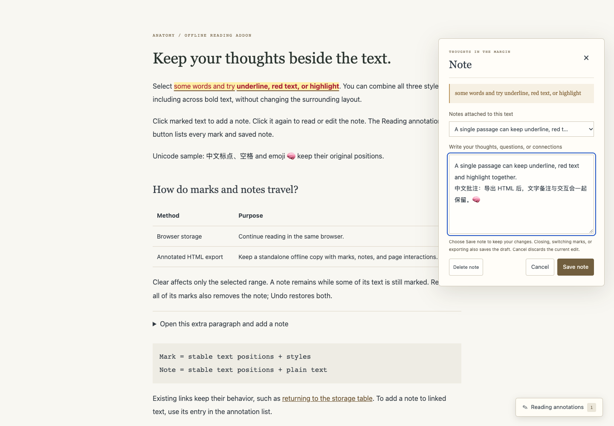
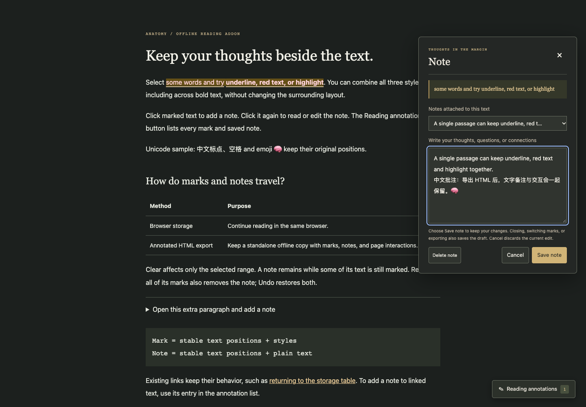
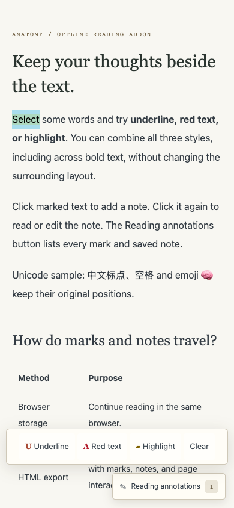
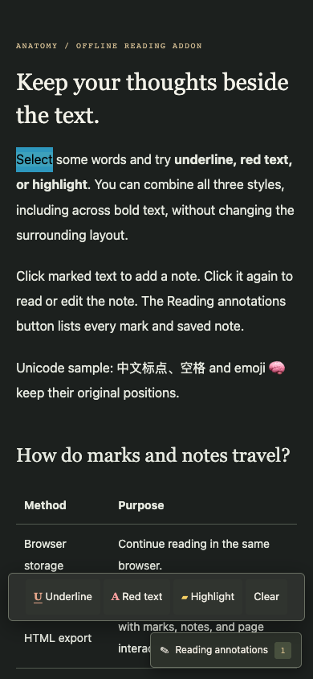
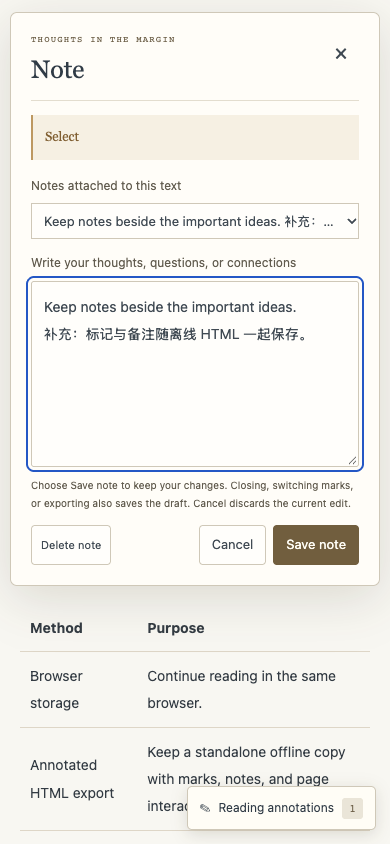
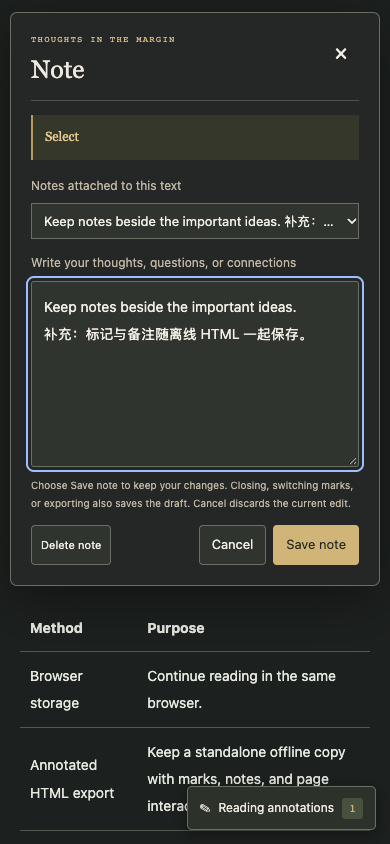
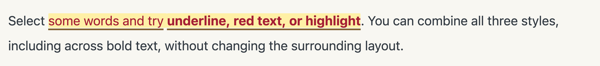
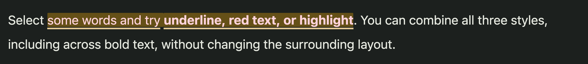

# Reading annotations: validation for PR #118

Validated on 2026-10-17, including the mouse re-selection fix in this PR.
Runtime SHA-256: `92b20fefedb1aa1c51ab15285fbf0031081244717d36adeed7fb6d6c393bf6b4`.

## Results

| Check | Result |
| --- | --- |
| Complete CI regression command | 325 passed, 0 failed, 0 skipped |
| Annotation model and light/dark standalone DOM suite | 46 passed, 0 failed, 0 skipped; these are included in the full regression count |
| Every framework-free example rebuild | All 14 commands passed, including both themes and turning-dial verify/stress builds |
| Existing examples preserved | All 48 tracked files under `examples/` remained byte-identical by SHA-256; working tree clean before and after rebuilding |
| Mobile touch emulation | 62 assertions passed across light and dark themes |
| Desktop browser interaction checks | 38 assertions passed across light and dark themes |
| Screenshot review | Eight images inspected: desktop, mobile toolbar/editor, and 4× mark details in both themes |

`git diff --check` passed. Local dependency versions exactly matched CI: React and ReactDOM 19.3.0, TypeScript 5.9.3, esbuild 0.28.2, and jsdom 24.1.3.

## Desktop selection and keyboard coverage

Real mouse drags across inline bold text and previously marked spans combine underline, red text, and highlight. Checks also cover add/edit/cancel, Enter, Ctrl+Enter, Escape, focus restoration, list navigation, shared history, browser persistence, and the original live slider. Downloaded HTML is reopened and re-exported in fresh offline contexts; marks, multilingual notes, literal HTML-like text, and independent notebook identities survive without duplicated controls or network requests.

These checks caught a Chromium interaction: starting a drag inside a span with `tabindex="0"` did not create a text selection. The runtime temporarily releases only the initiating primary-mouse mark's tabindex, then restores it on release, cancellation, window blur, the next keyboard event, or a new gesture. The failing browser case was reproduced before the fix; the final desktop checks run against the actual source without an injected workaround. DOM regressions cover restoration while retaining touch and right-click behavior.

## Mobile interaction coverage

Chrome's native long-press text selection was exercised with trusted touch input, followed by taps on the annotation controls. Each theme exercised four native long presses and trusted taps. Checks covered underline, red text, highlight, overlapping styles, clearing a mark and its note, undo/redo, plain-text note editing, cancel, and the original demo slider.

The toolbar, notes panel, and note editor fit the 390 × 844 portrait viewport. The notes panel and editor also fit 844 × 390 landscape, and the editor fit a constrained 320 × 420 viewport with Save reachable. No horizontal overflow was detected at mobile width.

Both themes passed browser autosave/reload, standalone HTML download, offline reopen, and re-export. The latest note draft survived export; HTML-like notes remained plain text. Exported pages initialized their original controls once and received independent notebook identities on re-export. No page errors or HTTP(S) requests were recorded.

This was **Chromium Android touch emulation**, using Chrome 155.0.8059.80 and Playwright 1.58.2 on macOS arm64. It was not a physical iOS or Android device test; a device's OS keyboard and platform selection handles were not tested.

## Reproduction

From the repository root, use Node and an installed Google Chrome. Browser QA needs Playwright only at verification time; delivered HTML has no runtime dependencies.

```sh
qa_deps="$(mktemp -d)"
npm install --prefix "$qa_deps" --no-audit --no-fund --ignore-scripts react@19.3.0 react-dom@19.3.0 typescript@5.9.3 esbuild@0.28.2 jsdom@24.1.3 playwright@1.58.2
NODE_PATH="$qa_deps/node_modules" node --test scripts/*.test.mjs assets/reading-annotations/*.test.mjs
NODE_PATH="$qa_deps/node_modules" node scripts/reading-annotations-desktop-qa.cjs shots/reading-annotations
NODE_PATH="$qa_deps/node_modules" node scripts/reading-annotations-mobile-qa.cjs shots/reading-annotations
```

The browser scripts build their own two-theme demos, save screenshots/results and downloaded HTML under the chosen output directory, and exit nonzero if a check fails. The default `shots/` directory is ignored by Git.

Run every committed framework-free build listed in CI:

```sh
node examples/dial-indicator/build.mjs
node examples/dial-indicator/build.mjs --light
node examples/desk-computer/build.mjs
node examples/desk-computer/build.mjs --light
node examples/arcade-cabinet/build.mjs
node examples/arcade-cabinet/build.mjs --light
node examples/ripple-tank/build.mjs
node examples/ripple-tank/build.mjs --light
node examples/turning-dial/build.mjs
node examples/turning-dial/build.mjs --light
node examples/turning-dial/build.mjs --light --verify
node examples/turning-dial/stress.mjs --light
node examples/raptor-engine/build.mjs
node examples/raptor-engine/build.mjs --light
git diff --exit-code -- examples
git status --short
```

Local runs used Node v25.5.0; the GitHub workflow specifies Node 22. These local passes do not establish the result of the remote workflow. Remote CI must still pass before merge; approval of fork workflow runs is controlled by the upstream maintainers.

## Screenshots

| View | Light | Dark |
| --- | --- | --- |
| Desktop |  |  |
| Mobile toolbar |  |  |
| Mobile note editor |  |  |
| Mark detail |  |  |
